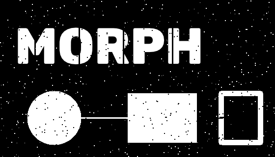
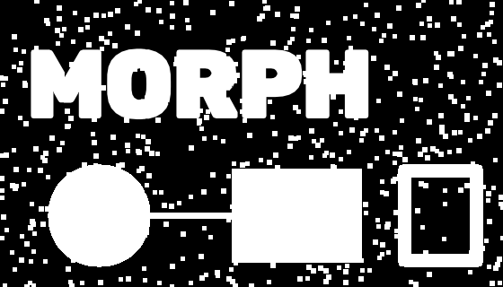
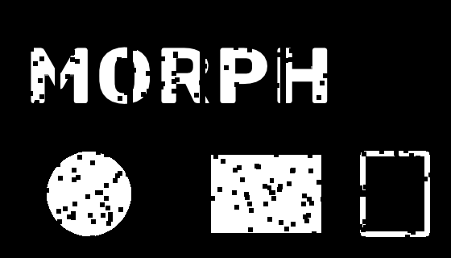
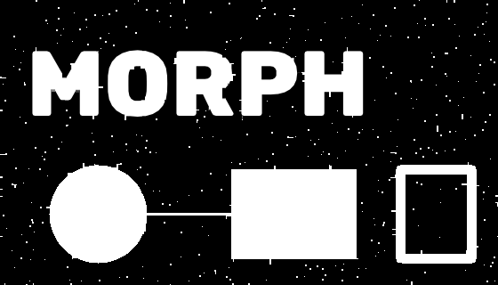
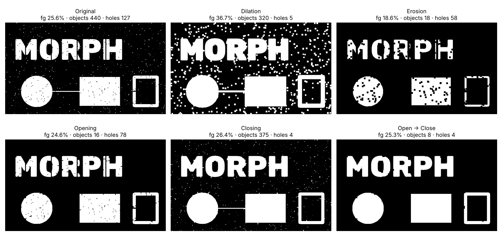

# 형태학적 이미지 처리: Dilation / Erosion / Opening / Closing

네 가지 연산을 **NumPy로 직접 구현**했습니다(`morphology.py`). OpenCV 함수(`cv2.dilate`, `cv2.erode`, `cv2.morphologyEx`)는 결과가 같은지 검증하는 데만 사용했고, 네 연산 모두 결과가 일치했습니다.

## 실행
```
python morphology.py                  # 테스트 이미지 생성 후 처리 (구조 요소: 5x5 사각형)
python morphology.py --input my.png   # 다른 이미지 사용 (Otsu 자동 이진화)
python morphology.py --ksize 7 --shape ellipse
```

## 구현 방법
구조 요소 B의 각 원소 위치만큼 이미지를 이동시킨 뒤 값을 누적합니다.
- **Dilation**: 이동한 이미지들의 최댓값(OR). 커널 안에 전경이 하나라도 있으면 전경이 됩니다.
- **Erosion**: 이동한 이미지들의 최솟값(AND). 커널 전체가 전경일 때만 전경이 됩니다.
- **Opening** = Erosion → Dilation
- **Closing** = Dilation → Erosion

## 사용한 이미지
변화가 잘 보이도록 아래 요소를 넣은 이진 이미지를 직접 만들었습니다.

| 요소 | 확인하려는 효과 |
|---|---|
| 배경의 흰 점(salt 노이즈) | Opening의 노이즈 제거 |
| 도형 내부의 검은 구멍(pepper 노이즈) | Closing의 구멍 메우기 |
| 글자·테두리의 끊어진 틈 | Closing의 틈 메우기 |
| 원과 사각형을 잇는 2px 얇은 선 | Erosion / Opening의 얇은 구조 제거 |

| Original | Dilation | Erosion |
|---|---|---|
|  |  |  |
| **Opening** | **Closing** | **Opening → Closing** |
|  |  |  |



## 결과 (구조 요소 5×5 사각형)

| 연산 | 전경 비율 | 객체 수 | 내부 구멍 수 |
|---|---:|---:|---:|
| Original | 25.6% | 440 | 127 |
| Dilation | 36.7% | 320 | 5 |
| Erosion | 18.6% | 18 | 58 |
| Opening | 24.6% | 16 | 78 |
| Closing | 26.4% | 375 | 4 |
| Opening → Closing | 25.3% | 8 | 4 |

## 비교 및 설명
- **Dilation (확장)**: 객체가 두꺼워져 전경 비율이 25.6%에서 36.7%로 늘었습니다. 내부 구멍과 글자의 틈은 거의 다 메워졌지만(127개 → 5개), 배경의 노이즈 점도 같이 커져서 오히려 더 눈에 띕니다.
- **Erosion (축소)**: 객체가 얇아져 전경 비율이 18.6%로 줄었습니다. 커널보다 작은 노이즈 점과 2px 선이 사라져 객체 수가 440개에서 18개로 줄었습니다. 대신 내부 구멍은 커지고 글자도 깎였습니다.
- **Opening (노이즈 제거)**: 침식으로 작은 점을 지운 뒤 팽창으로 크기를 되돌립니다. 그래서 객체 크기는 원본과 비슷하게 유지되면서(24.6%) 배경 노이즈와 얇은 선은 사라졌습니다(객체 16개). 다만 내부 구멍은 남아 있습니다.
- **Closing (빈틈 채우기)**: 팽창으로 구멍과 틈을 메운 뒤 침식으로 크기를 되돌립니다. 내부 구멍과 끊어진 틈이 메워졌지만(구멍 4개), 배경 노이즈는 그대로 남았습니다.
- **Opening → Closing**: 두 연산을 차례로 적용하면 노이즈와 구멍이 모두 정리되어 원래 도형 8개만 남습니다.
- **정리**: Dilation과 Erosion은 서로 반대 효과를 내며 객체 크기를 바꿉니다. Opening과 Closing은 크기를 거의 유지하면서 각각 "전경의 작은 것 제거"와 "배경의 작은 것 제거"를 합니다. 효과는 구조 요소의 크기에 달려 있어서, 커널보다 작은 구조만 제거되거나 메워집니다.
