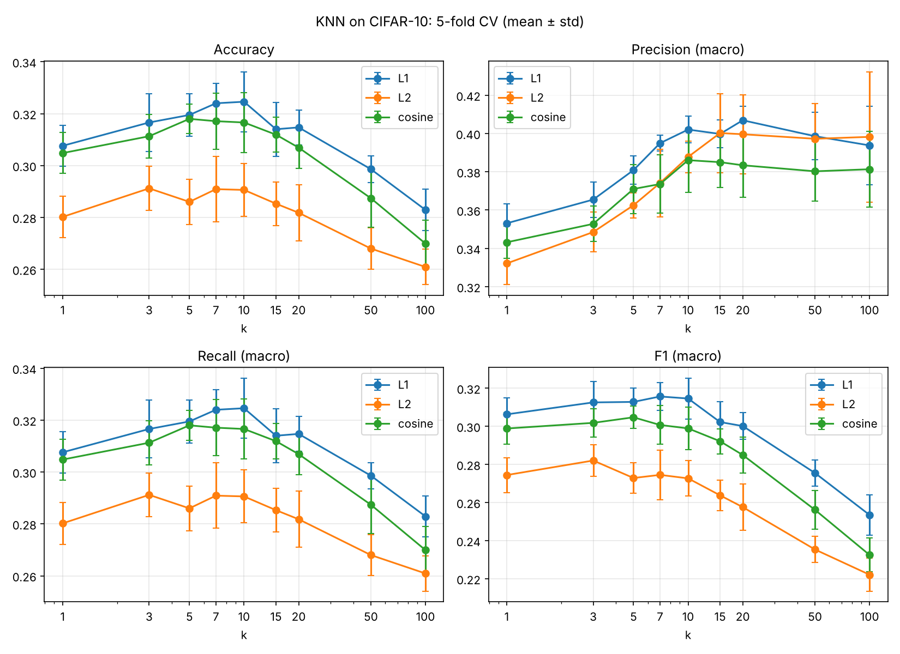
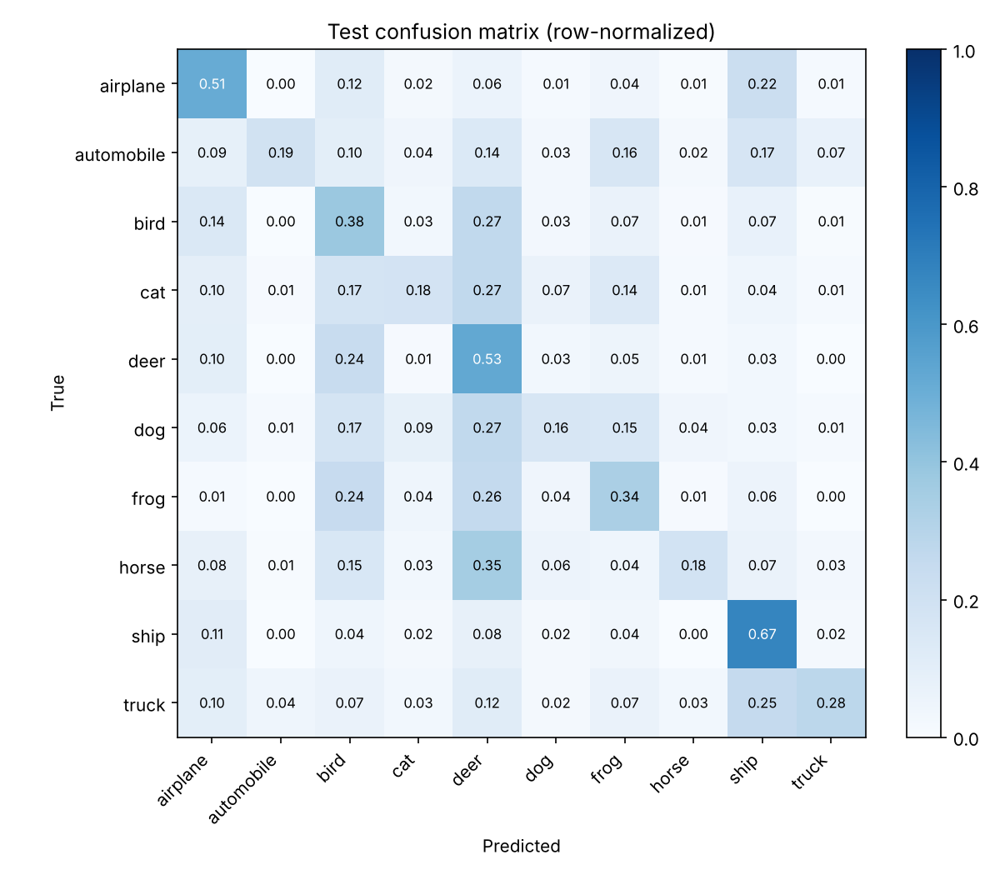

# KNN on CIFAR-10

KNN 분류기를 NumPy로 직접 구현해서 k 값과 거리 함수를 바꿔 가며 5-fold 교차검증으로 평가했습니다(`knn_cifar10.py`).

## 실행
1. [CIFAR-10 python version](https://www.cs.toronto.edu/~kriz/cifar.html)을 받아 압축을 풀고, `cifar-10-batches-py` 폴더를 이 폴더 안에 둡니다. 데이터셋은 용량 때문에 저장소에 포함하지 않았습니다.
2. 아래 명령으로 실행합니다.
```
python knn_cifar10.py --data-dir ./cifar-10-batches-py --n-train 10000 --n-test 2000
```

## 실험 설정
- **입력**: 32×32×3 이미지를 3072차원 벡터로 펼친 뒤 픽셀값을 /255로 정규화했습니다.
- **데이터**: 계산 시간 때문에 학습 데이터 50,000장 중 10,000장(클래스당 1,000장), 테스트 데이터 10,000장 중 2,000장을 층화 추출해 사용했습니다(seed 42).
- **k**: 1, 3, 5, 7, 10, 15, 20, 50, 100
- **거리 함수**: L1(Manhattan), L2(Euclidean), Cosine
- **검증**: Stratified 5-fold cross-validation
- **지표**: Accuracy, Precision, Recall, F1. Precision·Recall·F1은 10개 클래스의 macro 평균입니다.

## 결과

### 5-fold CV: 거리 함수별 최고 성능
| 거리 함수 | 최적 k | Accuracy | Precision | Recall | F1 |
|---|---:|---|---|---|---|
| **L1** | 10 | **0.325** ± 0.012 | 0.402 | 0.325 | **0.315** |
| Cosine | 5 | 0.318 ± 0.006 | 0.371 | 0.318 | 0.305 |
| L2 | 3 | 0.291 ± 0.008 | 0.349 | 0.291 | 0.282 |

전체 결과는 [`results/cv_summary.csv`](results/cv_summary.csv)에, fold별 결과는 [`results/cv_folds.csv`](results/cv_folds.csv)에 있습니다.



### 최종 테스트 (L1, k=10)
| Accuracy | Precision | Recall | F1 |
|---|---|---|---|
| 0.3415 | 0.4187 | 0.3415 | 0.3303 |



## 비교 및 설명
- **거리 함수**: L1 > Cosine > L2 순이었습니다. L2는 차이를 제곱하기 때문에 배경이나 위치가 달라 일부 픽셀 차이가 크게 나면 그 차이가 거리를 지배합니다. L1은 차이를 선형으로 더해서 이런 경우에 덜 민감합니다. Cosine은 전체 밝기를 무시하고 패턴만 비교하기 때문에 L2보다 성능이 좋았습니다.
- **k 값**: k=1은 가장 가까운 이미지 한 장에만 의존해서 노이즈에 민감합니다(과적합). k가 50이나 100처럼 크면 다른 클래스의 이미지까지 투표에 들어와 성능이 떨어집니다(과소적합). 성능은 k=5~10 근처에서 가장 좋았습니다.
- **지표 간 차이**: k가 커질수록 Precision은 올라가지만 Recall과 F1은 내려갑니다. 예측이 일부 클래스(ship, deer, airplane)로 쏠리기 때문입니다. 그래서 Accuracy만 보는 것보다 F1까지 함께 보는 것이 모델을 평가하는 데 더 정확합니다.
- **클래스별 성능**: ship(Recall 0.67)과 airplane(Recall 0.51)은 잘 맞혔고, cat(0.18)과 dog(0.16)은 잘 맞히지 못했습니다. 픽셀 거리는 물체 자체보다 배경색이 비슷한 이미지를 이웃으로 찾는 경향이 있기 때문에, 하늘이나 바다처럼 배경이 단순한 클래스에 유리합니다.
- **한계**: 원시 픽셀 공간(3072차원)에서는 거리의 의미가 약하고, 예측할 때마다 모든 학습 데이터와 거리를 계산해야 해서 느립니다. PCA, HOG, CNN 같은 특징을 추출한 뒤 KNN을 적용하면 성능을 높일 수 있습니다.
