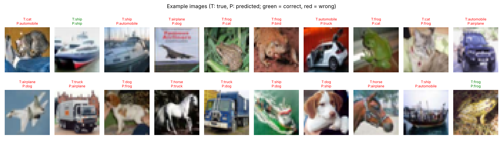
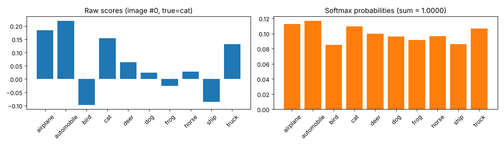
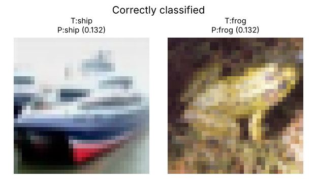
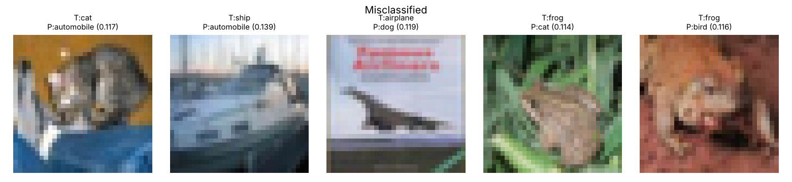
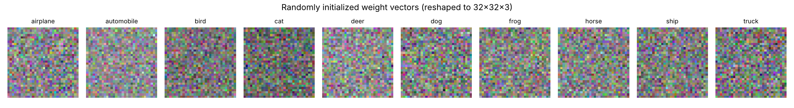

# CIFAR-10 선형 분류 과제 (무작위 초기화 가중치)

무작위로 초기화한 가중치로 선형 분류기 `f(x) = Wx + b`가 CIFAR-10 이미지의 클래스 점수를 계산하고 예측하는 과정을 확인한다. 모델 학습은 수행하지 않는다.

- 소스 코드 및 실행 결과: [`linear_classifier_cifar10.ipynb`](linear_classifier_cifar10.ipynb)
- 결과 그림: [`results/`](results/)

## 실행 방법

```bash
pip install numpy matplotlib jupyter
# https://cave.cs.toronto.edu/kriz/cifar.html 에서 CIFAR-10 python version을 받아
# 이 폴더에 압축 해제 → cifar-10-batches-py/
jupyter notebook linear_classifier_cifar10.ipynb
```

## 설정

| 항목 | 값 |
|---|---|
| 데이터 | `test_batch` 앞 20장 (평균 이미지는 `data_batch_1`로 계산) |
| 전처리 | 픽셀 / 255 후 평균 이미지 차감 |
| `W` | `0.01 * N(0, 1)`, 크기 (10, 3072), 시드 `42` (`np.random.default_rng`) |
| `b` | 0 벡터 (10,) |

## 1. `f(x) = Wx + b` 점수와 예측

| # | 정답 | 예측 | airplane | automobile | bird | cat | deer | dog | frog | horse | ship | truck |
|---|---|---|---|---|---|---|---|---|---|---|---|---|
| 0 | cat | automobile | 0.184 | **0.220** | -0.098 | 0.154 | 0.063 | 0.024 | -0.025 | 0.028 | -0.086 | 0.131 |
| 1 | ship | **ship ✓** | -0.072 | 0.147 | -0.137 | -0.217 | 0.159 | 0.195 | 0.080 | -0.069 | **0.336** | 0.030 |
| 2 | ship | automobile | -0.059 | **0.333** | -0.108 | -0.202 | -0.006 | 0.134 | -0.176 | 0.024 | 0.082 | -0.107 |
| 3 | airplane | dog | -0.053 | 0.266 | -0.249 | 0.029 | 0.130 | **0.294** | 0.217 | 0.144 | 0.117 | 0.162 |
| 4 | frog | cat | -0.123 | -0.090 | -0.041 | **0.110** | -0.110 | -0.135 | 0.085 | -0.067 | 0.080 | 0.057 |

(20장 전체 결과는 노트북 참고)



## 2. 다중 클래스 SVM hinge loss

$L_i = \sum_{j \neq y_i} \max(0,\ s_j - s_{y_i} + 1)$

- 20장 평균 SVM loss = **9.1646**
- 점수가 모두 0 근처일 때 각 오답 클래스가 margin 1씩 기여하므로 손실은 약 K − 1 = 9가 된다. 이 결과는 W가 작게 초기화되었다는 점과 맞는다. 학습 초기 sanity check로 쓰이는 값이다.

## 3. Softmax

| class | score (#0, cat) | prob |
|---|---|---|
| airplane | 0.1839 | 0.1126 |
| automobile | 0.2200 | 0.1168 |
| bird | -0.0982 | 0.0849 |
| cat | 0.1538 | 0.1093 |
| deer | 0.0629 | 0.0998 |
| dog | 0.0242 | 0.0960 |
| frog | -0.0253 | 0.0914 |
| horse | 0.0284 | 0.0964 |
| ship | -0.0865 | 0.0859 |
| truck | 0.1313 | 0.1069 |

- 20장 모두 클래스별 확률의 합이 1임을 확인했다 (`np.allclose(sum, 1) → True`).
- Softmax는 단조 증가 함수라서 점수 순위가 그대로 유지된다. 따라서 argmax 예측은 바뀌지 않는다.
- 점수 차이가 작아 모든 확률이 0.1 근처에 몰려 있다(거의 균등 분포). 평균 cross-entropy loss는 2.3286으로, 이론값 −log(1/10) ≈ 2.3026과 비슷하다.



## 4. 올바른 분류 / 잘못된 분류 사례

20장 중 정답 2장, 오답 18장 (정확도 10%로, 무작위 추측 수준과 같다).

| 구분 | 예시 |
|---|---|
| 정답 | #1 ship → ship (p=0.132), #19 frog → frog (p=0.132) |
| 오답 | #0 cat → automobile, #2 ship → automobile, #3 airplane → dog, #4 frog → cat, #5 frog → bird |




**설명**: W가 무작위이므로 점수는 이미지 내용과 무관한 무작위 투영값이다. 정답을 맞힌 사례도 모델이 배를 "인식"했기 때문이 아니다. 우연히 정답 클래스의 점수가 가장 높았을 뿐이며, 예측 확률도 0.13 정도로 확신이 거의 없다. 오답은 의미상 비슷한 클래스(cat↔dog 등)와 헷갈린 것이 아니라 무작위로 흩어져 있다.

## 5. 클래스별 가중치 시각화



**설명**: 각 행 `W[k]`는 클래스 k의 템플릿이다. 점수 `W[k]·x`는 입력 이미지와 이 템플릿의 내적(유사도)이다. 학습을 하면 손실을 줄이는 방향의 경사하강법이 W를 갱신하므로, 템플릿은 해당 클래스 이미지들의 평균적인 색과 형태를 닮아 간다. 예를 들어 airplane과 ship은 파란 배경, horse는 갈색 몸통 형태가 나타난다. 그러나 여기의 W는 데이터를 한 번도 보지 않고 정규분포에서 각 원소를 독립적으로 뽑은 값이다. 그래서 인접 픽셀 사이에 공간적 상관관계가 없고 어떤 클래스와도 관련이 없다. 결과적으로 10개 클래스 모두 서로 구분되지 않는 컬러 노이즈로 보인다.
